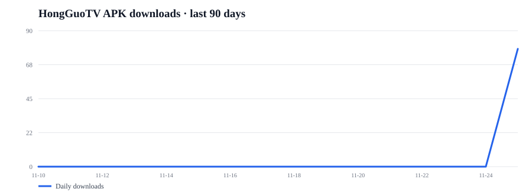

# AppDownload

**红果TV Android APK 下载与版本更新仓库，提供最新版安装包、自动更新清单及历史版本信息。**

本仓库由第三方维护，集中提供红果 TV（HongguoTV）Android 应用安装包（APK）、版本信息、应用内更新清单和下载说明。用户可以在这里获取本仓库发布的最新版本，并通过固定的更新清单地址检查新版本。本仓库与红果 TV 官方运营主体无隶属或授权关系。

**项目关键词：** 红果TV、HongguoTV、Hongguo TV、Android、安卓应用、APK 下载、应用更新、版本发布、latest.json。

**English:** AppDownload is a community-maintained, third-party Android APK download and app update repository for HongguoTV. It provides APK releases, version metadata, and the app's update manifest. It is not affiliated with or endorsed by the official HongguoTV operator.

## 最新版本

<!-- BEGIN APP: hongguoTV -->
### 红果 TV

当前版本：**2.0.3**

- [下载最新版 HongguoTV-2.0.3.apk](https://github.com/xycvip/AppDownload/releases/download/hongguotv-v2.0.3/HongguoTV-2.0.3.apk)
- [应用内更新清单 latest.json](https://raw.githubusercontent.com/xycvip/AppDownload/main/hongguoTV/latest.json)
- [红果 TV 全部下载文件与说明](https://github.com/xycvip/AppDownload/tree/main/hongguoTV)

**本次更新说明**

【播放体验】
- 替换播放页废弃方向图标
- 将双播放器内存门槛调整为300
- 保证视频总长度在预读线程间可见
- 修复播放流准备期间取消导致的资源泄漏
- 修复旧 上 响应 解码兼容
【页面与操作】
- 替换 页面废弃方向图标
【搜索与内容】
- 替换搜索页废弃方向图标
- 修复分类分页竞态并优化网络与弹幕生命周期
【网络与稳定性】
- 修复 与 2.4 元数据版本兼容
- 修复 接口 编译错误
- 区分网络超时与请求取消的重试策略
- 避免预读线程运行时异常导致进程崩溃
- 允许调用方限制网络重试总次数
- 限制预读重试并加固热更新脚本网络访问
- 确保预读异常清理状态后再传播非网络错误
- 确保 超时立即取消底层网络请求
- 修复 请求取消与分页计数及预读异常处理
【其他功能】
- 兼容新版 内存回调并清理废弃常量
- 清理旧版系统栏 警告
- 减少脚本响应复制并补齐特殊地址拦截
- 统一预读重试预算并清理过期失败记录
<!-- END APP: hongguoTV -->

<!-- BEGIN APP: redguo -->
### 红果剧场

当前版本：**1.0.2**（内部版本 `2026112201`）

- [下载 32 位安装包 RedGuo-1.0.2-v7a.apk](https://github.com/xycvip/AppDownload/releases/download/redguo-v1.0.2-2026112201/RedGuo-1.0.2-v7a.apk)
- [下载 64 位安装包 RedGuo-1.0.2-v8a.apk](https://github.com/xycvip/AppDownload/releases/download/redguo-v1.0.2-2026112201/RedGuo-1.0.2-v8a.apk)
- [应用内更新清单 update.json](https://raw.githubusercontent.com/xycvip/AppDownload/main/redguo/update.json)
- [红果剧场全部下载文件与说明](https://github.com/xycvip/AppDownload/tree/main/redguo)

**本次更新说明**

- 修复连续切换几集后必然卡住转圈、返回后重新点开也无法播放的问题：被取消的请求会一直占着网络限流名额不放，名额占满后所有请求排队直到超时；现在取消时立即释放名额，前台排队加了上限，排队超时也会自动重试，不再出现「一直转圈」。
- 修复切集时偶发「Unexpected runtime error」导致备用预热失效、连播不无感的问题：两路播放器统一缓冲参数，不再在切集时翻转内核内部状态。
- 取消双播放器的内存限制：是否预热只由「预开下一集」开关决定，内存紧张的设备也能无感切集。
- 精简为仅安卓版本：移除 iOS / Windows / macOS 平台代码与桌面专属功能（桌面小窗、老板键、窗口置顶、窗口全屏等），安装包只含 ARM 架构，不再提供 x86 模拟器架构与 32+64 整合包。
- 播放调试日记区分音频与视频轨道：AAC 音频走软解属正常现象，不再误读成视频掉软解。
<!-- END APP: redguo -->

## 仓库用途

AppDownload 是应用发布与下载分发仓库，不是 Android 源代码仓库。应用源码、开发过程和功能实现请以对应的源码项目为准。

### 应用目录

- `hongguoTV/`：红果 TV（HongguoTV）Android APK 发布文件与应用内更新清单。
- `redguo/`：红果剧场（RedGuo）Android APK 发布文件与应用内更新清单。

### 下载与更新

1. 普通用户可通过上方最新版 APK 链接下载安装。
2. 应用内更新功能读取固定地址的 `hongguoTV/latest.json`，获取版本信息和下载地址。
3. 历史版本及对应发布说明可在 [Releases](https://github.com/xycvip/AppDownload/releases) 页面查看。

### 分发规则

- APK 文件名包含版本号，每个应用只保留当前最新 APK。
- 每个应用使用固定的 `latest.json` 更新清单地址，避免应用内更新地址频繁变化。
- APK、更新清单及本说明由对应应用源码仓库的 GitHub Actions 自动更新。
- 本仓库不存放签名私钥、密码或访问令牌。

## Repository Information

- Repository: `xycvip/AppDownload`
- Project: Third-party HongguoTV Android APK downloads and updates
- Distribution: GitHub Releases and GitHub Raw
- Manifest: `hongguoTV/latest.json`

如需反馈下载或更新问题，请通过本仓库的 Issues 提交，并注明设备型号、Android 版本和遇到的问题。

<!-- HONGGUOTV_STATS_START -->
## 红果TV统计

**累计下载：2,753 次** · **最新版本：红果TV正式版 2.0.2**

| 历史版本 | 下载量 |
| --- | ---: |
| 红果TV正式版 2.0.2 | 75 |
| 红果TV正式版 2.0.1 | 56 |
| 红果TV正式版 2.0.0 | 117 |
| 红果TV正式版 1.1.50 | 289 |
| 红果TV正式版 1.1.49 | 808 |
| 红果TV正式版 1.1.48 | 45 |
| 红果TV正式版 1.1.47 | 338 |
| 红果TV正式版 1.1.46 | 234 |
| 红果TV正式版 1.1.45 | 87 |
| 红果TV正式版 1.1.44 | 9 |
| 红果TV正式版 1.1.43 | 41 |
| 红果TV正式版 1.1.42 | 4 |
| 红果TV正式版 1.1.41 | 82 |
| 红果TV正式版 1.1.40 | 5 |
| 红果TV正式版 1.1.39 | 32 |

**每日下载趋势**

**仓库访问趋势**

仅统计红果TV正式版 APK。访问数据需配置 TRAFFIC_TOKEN。
<!-- HONGGUOTV_STATS_END -->
